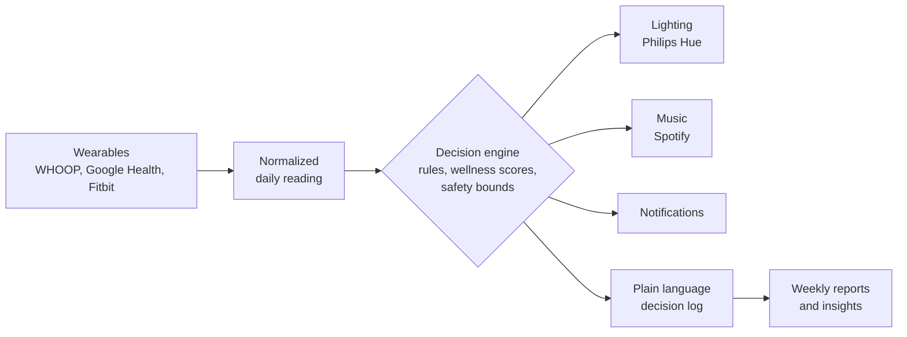
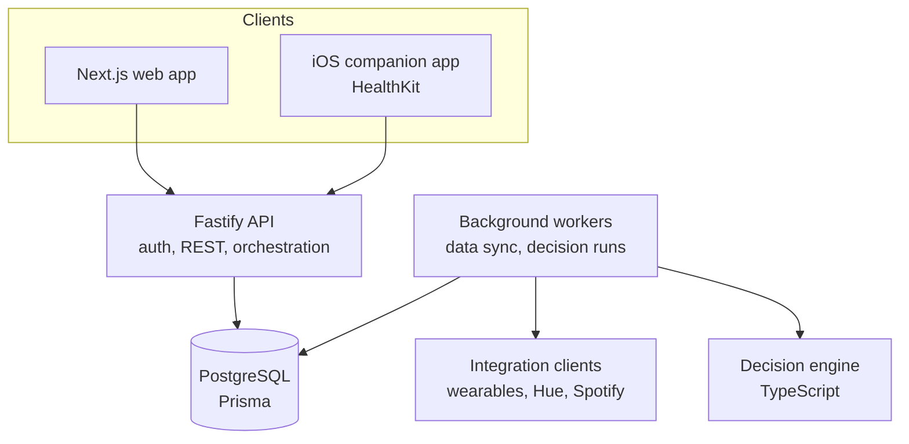

# 

## 

**trilegal** · intern  
made presentations and analyzed cases at a tier 1 law firm.

**nature's note** · founder  
built the [website and online store](https://naturesnotefragrances.com) for a natural fragrance brand ([project breakdown](https://github.com/anaygoyal7878-del/natures-note-website)).

**[fire risk modeling](https://github.com/anaygoyal7878-del/fire-risk-modeling)** · machine learning project  
a model that predicts fire risk.

## 

**[moodsync](https://github.com/anaygoyal7878-del/moodsync)** · wearable data meets the smart home  
reads recovery, sleep and heart rate from a wearable, decides what the environment should do, then adjusts lighting, music and notifications.

## 

typescript · python · react · next.js · node.js · fastify · postgresql · sql · supabase · tailwind · swift

looking for software engineering opportunities. reach me at [anay.goyal7878@gmail.com](mailto:anay.goyal7878@gmail.com) or on [linkedin](https://www.linkedin.com/in/anay-goyal-4b7090382).
