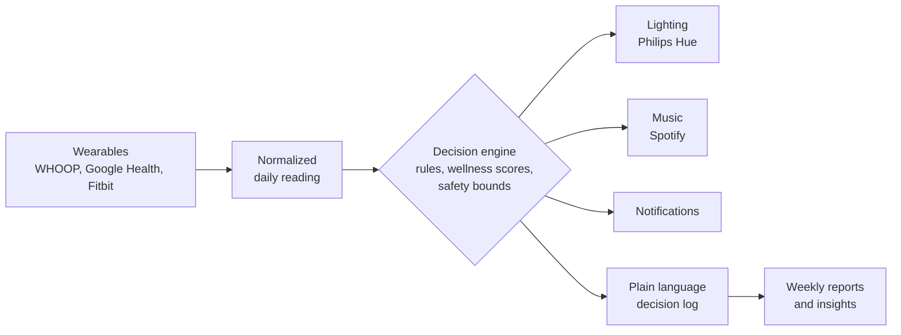
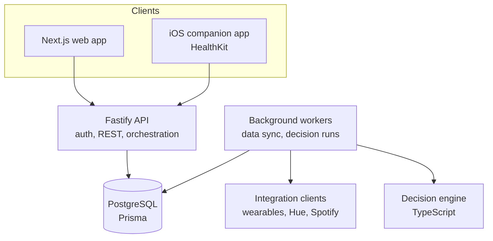

# 

Software developer building web and iOS applications and machine learning systems, with a focus on health technology and applied research.

## 

- 🔬 [Fire risk modeling](https://github.com/anaygoyal7878-del/fire-risk-modeling) is one of my machine learning projects.
- 🌿 I built the [Nature’s Note website and online store](https://naturesnotefragrances.com) ([project breakdown](https://github.com/anaygoyal7878-del/natures-note-website)).
- ⚖️ I interned at Trilegal, a tier 1 law firm, where I made presentations and analyzed cases.

## 

**[MoodSync](https://github.com/anaygoyal7878-del/moodsync)** connects a person's wearable health data to the smart home they already own. It reads biometric signals such as recovery, sleep and heart rate, decides what the environment should do, and then adjusts lighting, music and notifications.

**How a reading becomes an action**

**System architecture**

Stack: TypeScript, Next.js, Fastify, PostgreSQL, Prisma and Swift. See the [full write up](https://github.com/anaygoyal7878-del/moodsync).

---

- 🌱 I'm currently working in TypeScript, Python, React, Next.js, Node.js, Fastify, PostgreSQL, SQL, Supabase, Tailwind and Swift.
- 🤝 I'm looking for software engineering opportunities.
- 📫 Reach me at [anay.goyal7878@gmail.com](mailto:anay.goyal7878@gmail.com) or on [LinkedIn](https://www.linkedin.com/in/anay-goyal-4b7090382).
